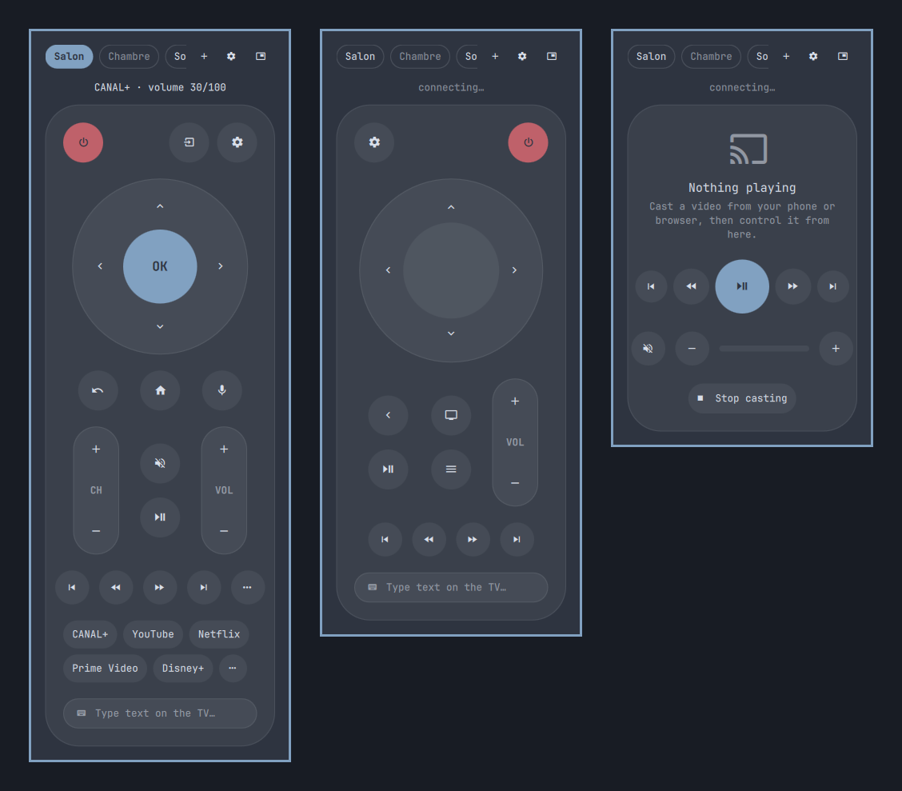

# Universal TV Remote — Omarchy bar plugin

One remote for every TV and streaming box on your network, right in the
Omarchy bar. It finds your devices, pairs them, and draws a remote tailored to
each one.



| Device | Remote | Pairing |
|---|---|---|
| Google TV / Android TV — Chromecast with Google TV, Google TV Streamer, NVIDIA SHIELD, Sony, TCL, Philips… | D-pad, CH/VOL rockers, microphone, app shortcuts | code shown on the TV |
| Fire TV and other Android devices with network ADB | D-pad, media keys, installed apps | accept on the TV |
| Apple TV | Siri Remote: clickpad, back, TV, volume, the Apple TV's own apps | code shown on the TV (sometimes two) |
| Samsung TV (Tizen, 2016+) | classic TV remote: digits, channels, source, color keys | accept on the TV |
| LG TV (webOS) | classic TV remote | accept on the TV |
| Roku | classic TV remote | none |
| Plain Chromecast, Cast speakers | now playing + volume | none |

## Features

- **Bar button** with the current app and volume. Click: remote ·
  scroll: volume · right click: play/pause · middle click: mute.
- **Remote per device kind** (Google TV, Apple TV, classic TV, Cast), themed
  with Omarchy's colors and restyled when you switch themes.
- **Add a device** (`󰐕`): automatic network discovery, or by IP address. Pairing
  happens in the popup: type the code shown on the TV, or accept the request.
- **Now playing**: title, artist and progress for Cast sessions and Apple TV.
- **App shortcuts**: read from the device (Apple TV, Samsung, LG, Roku, Fire TV)
  or learned from the apps you open (Google TV).
- **"Sound goes through"** (`󰒓`): when a streaming box can't control the TV
  volume (infrared-only remote), volume keys go to another device — for
  example the TV itself.
- **Floating window** (`󰹙`): detach the remote; it stays on top on every
  workspace. Drag the grip to move it, `󱔓` docks it back.
- **Keyboard**: arrows, Enter, Backspace, Space, `+`/`-`, `m`, `h`, `p`; Esc closes.
  Press and hold any key for a long press.
- **Terminal remote** too (see below), and IP changes (DHCP, moving house)
  are handled: devices are found again by their id.

## Install

```bash
omarchy plugin add https://github.com/faperac/omarchy-tv-remote.git --enable
```

Click the `󰔂` button in the bar and press **Install**: the first run creates a
private Python environment with the pinned dependencies (one time, about
40 MB). Then add your devices with `󰐕`.

**Requirements:** Python 3.11+ (ships with Omarchy). `uv` is used when present,
otherwise `python -m venv` + `pip`. The microphone button needs `arecord`
(alsa-utils, ships with Omarchy).

Optional — start the service with your session instead of on first click:

```bash
cp ~/.config/omarchy/plugins/faperac.tv/systemd/omarchy-tv.service ~/.config/systemd/user/
systemctl --user enable --now omarchy-tv
```

Optional — keyboard shortcuts in `~/.config/hypr/bindings.lua`:

```lua
o.bind("SUPER + ALT + T", "TV remote", "omarchy-shell faperac.tv toggle")
o.bind("SUPER + ALT + EQUAL", "TV volume up", "omarchy-shell faperac.tv.remote press vol+")
o.bind("SUPER + ALT + MINUS", "TV volume down", "omarchy-shell faperac.tv.remote press vol-")
```

## Terminal

The bundled CLI drives the same service (link it as `tv` if you like:
`ln -s ~/.config/omarchy/plugins/faperac.tv/bin/omarchy-tv ~/.local/bin/tv`):

```
tv                       full-screen remote (keyboard + mouse, adapts to the window)
tv discover              find devices
tv add 2 [NAME]          add the 2nd device found (or: tv add 192.168.1.20)
tv living vol+ vol+      keys; tv netflix; tv text:"dune"
tv living status         device state
tv list                  devices and keys
```

## Remove

```bash
omarchy plugin remove faperac.tv
systemctl --user disable --now omarchy-tv 2>/dev/null
rm -f ~/.config/systemd/user/omarchy-tv.service
rm -rf ~/.config/omarchy-tv ~/.local/share/omarchy-tv
```

## How it works

A small service (`bin/omarchy-tv daemon`) keeps the connections open,
publishes the state to `$XDG_RUNTIME_DIR/omarchy-tv/status.json` and receives
commands through a named pipe. The bar, the popup, the floating window and the
terminal remote are all clients of it.

- **Discovery** combines a long-running mDNS listener, an Apple TV scan, the
  Cast setup API, and a probe of well-known ports on the local /24 — Omarchy's
  ufw firewall blocks SSDP replies, so classic UPnP discovery isn't enough.
- **Protocols**: Android TV Remote v2 (no developer mode), Cast, Companion /
  AirPlay (Apple TV), Samsung and LG websocket APIs, Roku ECP, ADB over TCP.

## Dependencies, data and security

- Python libraries, pinned and installed with `--require-hashes` from
  [`bin/requirements.lock`](bin/requirements.lock):
  [androidtvremote2](https://github.com/tronikos/androidtvremote2),
  [pyatv](https://pyatv.dev/), [samsungtvws](https://github.com/xchwarze/samsung-tv-ws-api),
  [aiowebostv](https://github.com/home-assistant-libs/aiowebostv),
  [pychromecast](https://github.com/home-assistant-libs/pychromecast),
  [adb-shell](https://github.com/JeffLIrion/adb_shell), zeroconf, aiohttp.
  Nothing is downloaded until you press **Install** (or run `omarchy-tv setup`).
- Everything stays on your local network; no cloud account, no telemetry.
- Configuration in `~/.config/omarchy-tv/`; pairing keys and tokens are
  stored with mode 600. The plugin never edits your Omarchy or Hyprland config.

## Test status

Tested on real hardware with Google TV (Chromecast HD, Google TV Streamer) and
Android TV (Sony Bravia 2015). The Fire TV, Apple TV, Samsung, LG, Roku and
plain Chromecast drivers follow their libraries' documentation but haven't been
tried on hardware yet — issues and feedback are very welcome.

## License

MIT
